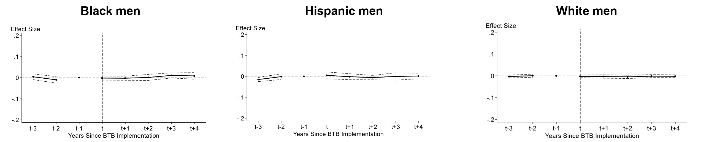

**Bachelor's thesis in Economics, Aalto University, 2026 (grade 5/5)** 
[View the code on GitHub](https://github.com/nooavon/Evaluating-Fair-Chance-Employment-Replication-Package){: .btn .btn--primary}
[Read the thesis](https://aaltodoc.aalto.fi/server/api/core/bitstreams/dcaf1d0e-bfb8-438e-aa66-01f0b5cb9bf2/content){: .btn .btn--primary}

## Question

Ban the Box (BTB) laws stop employers from asking about criminal records early in the hiring process. Economists have worried that employers might replace the missing information with observable proxies such as race, and end up discriminating against young minority men who have no criminal record at all.

Earlier research has found mixed results. My thesis builds on the work of Burton and Wasser (2025) by extending their analysis and comparing the findings with other recent studies.

## Data and method

- Annual **American Community Survey (ACS)** microdata from IPUMS, 2004–2019.
- Sample: U.S.-citizen men aged 25–34 without a bachelor's degree, split into Black, Hispanic and White groups.
- **Difference-in-differences** design, with BTB treatment assigned at the metropolitan area level.

## My contributions to Burton and Wasser (2025)

- Reproduced the original 2004–2014 results, then extended the data to 2019 and updated the annual BTB law coding.
- Tested parallel trends with event studies, and ran robustness checks on policy adoption, migration and the 2008–2009 recession.
- Compared the results with those of Kaestner and Wang (2024), who studied the same 2004–2019 period using Current Population Survey data.

## Result

Across the three groups, the thesis finds **no robust employment effects** of Ban the Box. The result aligns with Burton and Wasser (2025) and Kaestner and Wang (2024).

Effect of BTB on the probability of employment, 2004–2019 ACS data, preferred specification:

| Group        | Effect (percentage points) | Standard error | Relative to pre-BTB mean |
|--------------|---------------------------:|---------------:|-------------------------:|
| Black men    |                      +0.49 |           0.43 |                   +1.09% |
| Hispanic men |                      −0.04 |           0.61 |                   −0.06% |
| White men    |                      +0.28 |           0.21 |                   +0.37% |

*None of the effects is statistically significant. All specifications include metropolitan area and year-by-region fixed effects, demographic controls and metropolitan area trends. The sample starts in 2008 for Black and White men and in 2010 for Hispanic men, whose earlier data failed the parallel trends test.*

*Event-study estimates with 95% confidence intervals, 2008–2019 ACS data. Employment barely moves before or after a BTB law is adopted. Hispanic men show one significant lead three years before adoption, which is why their preferred sample starts in 2010.*

## Why it matters

Policies are often debated on intuition about how people and firms will react. This project shows how to test such a claim with data: replicate an existing study, check whether its assumptions hold, and see whether the result survives a longer time window and alternative specifications. The same workflow applies to evaluating any policy or business intervention.

*Tools: Stata. This is an independent extension of Burton and Wasser's study, not a release by the original authors.*
