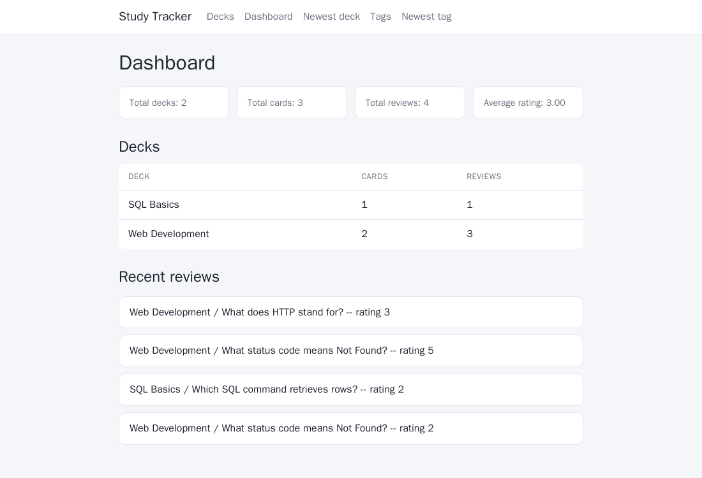

**Databases for Data Science course project, Aalto University, 2026** 
[View the code on GitHub](https://github.com/nooavon/study-tracker){: .btn .btn--primary}

## Goal

Build a working web app on top of a relational database, and document the data model behind it: what the entities are, how they relate, and why the schema is shaped the way it is.

## What it does

- **Decks and cards:** create, edit and delete flashcard decks and the question–answer cards inside them.
- **Tags:** label cards with reusable tags (a many-to-many relationship).
- **Study mode:** shows the card you reviewed longest ago (never-reviewed cards first), then you rate how well you remembered it from 1 to 5.
- **Dashboard:** totals, the average rating, per-deck card and review counts, and the latest reviews.

## Database design

- Five tables: decks, cards, tags, a card–tag link table and an append-only reviews table. Schema changes are made with numbered SQL migration files that run on start-up.
- Rules are enforced in the database itself: unique deck names, ratings limited to 1–5 with a `CHECK` constraint, and cascading deletes so removing a card also removes its reviews.
- All queries are hand-written, parameterised SQL with no ORM, including joins and aggregates for the dashboard, plus indexes on the main foreign keys.
- The [design documents](https://github.com/nooavon/study-tracker/tree/main/design) include an ER diagram, a reading of the domain, and a rationale. They separate what the app does now from what a production version would still need, such as user accounts, access control and data retention rules.

*Tools: Python, FastAPI, Jinja2, PostgreSQL, psycopg 3, Docker Compose.*
