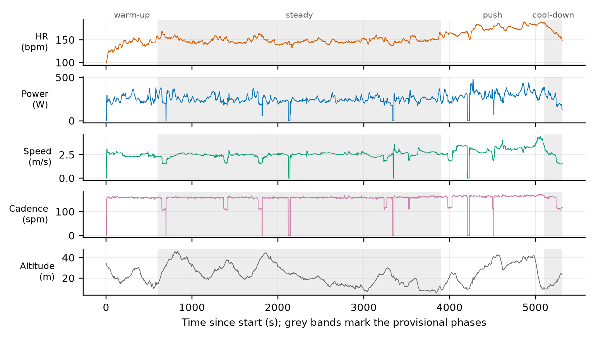
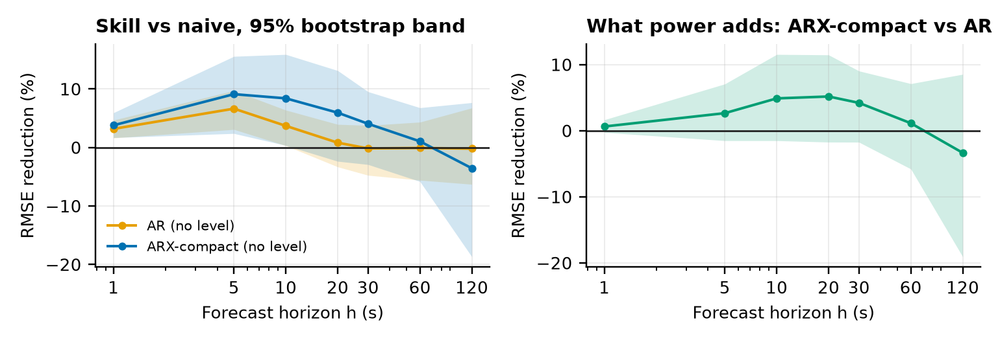

**Forecasting Methods in Business Analytics course project, Aalto University, 2026** 
[View the code and report on GitHub](https://github.com/nooavon/Forecasting-heart-rate-in-a-run){: .btn .btn--primary}

## Question

Does knowing a runner's power output help forecast where their heart rate is heading in the next few seconds or minutes?

*The data: one 88-minute run recorded once per second with a Garmin watch (5,313 observations). The grey bands mark the warm-up, steady, push and cool-down phases.*

## Approach

- Forecast the change in heart rate over horizons of 1, 5, 10, 20, 30, 60 and 120 seconds, with a separate regression for each horizon.
- Compared **naïve baselines**, **autoregressive (AR)** models on recent heart-rate changes, **ARX** models that add raw and smoothed running power, and a **state-space model** in which heart rate relaxes towards a power-driven target, estimated with a Kalman filter.
- Evaluated every model fully out of sample with a rolling origin, refitting every 60 seconds. Accuracy is measured as RMSE skill relative to the naïve forecast.
- Checked the differences with Diebold–Mariano tests, a moving-block bootstrap, comparisons across phases of the run, and 11 alternative design choices.

## Key findings

- **The naïve forecast ("heart rate stays the same") is hard to beat.** At one sample per second heart rate is very smooth, so the last value is already a strong forecast.
- **The best model beats naïve by 4–9% at 1–10 seconds.** In absolute terms the gains are small: at 10 seconds the error drops from 2.66 to 2.44 bpm.
- **Running power helps most at 5–30 second horizons**, mainly during the high-effort push at the end of the run.
- **No model reliably beats naïve at 60 seconds or longer.** Future power is unknown, and the link between power and heart rate drifts as the run goes on. Given the true future power, the state-space model reaches 7–8% skill at 60–120 seconds, so forecasting power is the main bottleneck.
- **Heart rate responds to a sustained change in power with a delay.** It reaches 63% of the final effect after about 50 seconds and settles at roughly 0.17 bpm per watt.

*Left: RMSE reduction relative to the naïve forecast for the AR and ARX models. Right: the extra gain from adding running power (ARX vs AR). Shaded areas are 95% block-bootstrap bands.*

All results come from one run by one person, and some model variants were chosen after looking at test errors, so the findings are a case study rather than a general result.

*Tools: Python, NumPy, pandas, statsmodels, Jupyter.*
